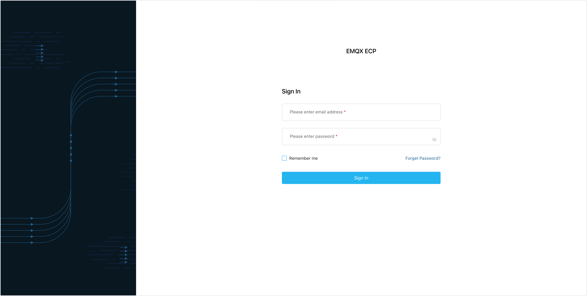

# Authentication

The ECP authentication system is an essential component for verifying user identities. It encompasses various functionalities such as user account management, authentication, authorization, and access control. These features collectively provide a reliable, secure, and user-friendly mechanism for authenticating users within the ECP platform. 

ECP offers two methods for authenticating user login: [basic authentication](#log-in-with-username-and-password) and [single sign-on](./sso.md) using OIDC or SAML 2.0.

## Log in with Username and Password

Superusers can [create or invite](../system_admin/user_management.md) ECP admins or regular users. After these users are added, they can log in to ECP, with their email address and password.

You also have the option to check the **Remember me** checkbox, which enables the automatic filling of your login credentials for future logins.

If a system admin has turned on two-factor authentication, local accounts must complete authenticator binding or enter the current verification code after a correct password before entering the system. See [Two-Factor Authentication (TOTP)](./totp_mfa.md) for details.

## Reset Password

If you forget your password, click the **Forgot Password** button on the login page. You'll be guided to contact your system admin or reset your password through email.
