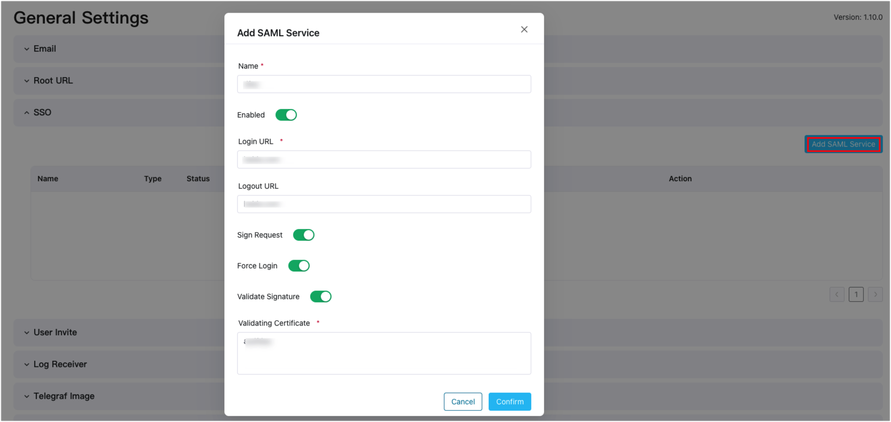

# SAML

ECP supports integration with SAML 2.0 identity providers. For OIDC, see [OIDC](./oidc.md).

[SAML (Security Assertion Markup Language)](https://en.wikipedia.org/wiki/Security_Assertion_Markup_Language) is an XML-based open standard protocol used for exchanging authentication and authorization data in cross-network communications. SAML aims to facilitate secure communication and enable single sign-on (SSO) for user authentication across various network resources.

## Configure SAML

1. Log in as system admin.

2. Click **System Settings** -> **General Settings** -> **SSO**.

3. Click **Add Identity Provider**, select **SAML 2.0** for **Protocol**, and configure the following settings.

   - Input a **Name** for the SSO configuration.
   - Toggle the **Enabled** switch to enable SSO.
   - Input the **Login URL**, which is the login address of the third-party authentication system.
   - [Optional] Input the **Logout URL**, which is the logout address of the third-party authentication system.
   - [Optional] Toggle the **Sign Request** switch to enable request signing. ECP will automatically generate a signature if enabled.
   - [Optional] Toggle the **Force Login** switch to require users to enter their username and password every time they log in through the third-party SSO.
   - [Optional] Toggle the **Validate Signature** switch to enable signature validation. Upload the public key file exported from the third-party authentication system, encrypted in Base64 format.
   - [Optional] Toggle the **Auto Bind IdP User** switch to enable auto bind with third-party authentication system. If enabled, the email address used by the third-party authentication system will be auto bound to the user account on ECP side. When the user log into ECP uses SSO, the user account on ECP side will be automatically created or activated. If not enabled, when a user logs into ECP for the first time using SSO,  the user is required to manually fill out the registration information to complete user account creation on ECP side.
   - Click **Confirm** to finish the setting.

