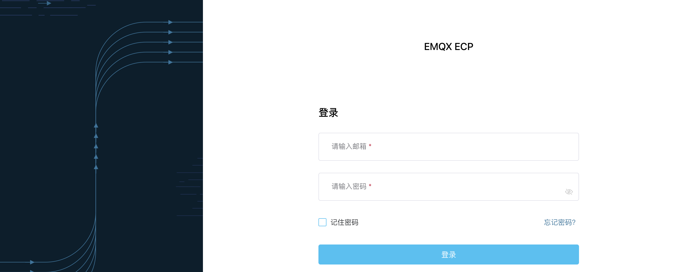

# ECP 登录认证

ECP 认证系统用于验证用户身份，包括用户帐户管理、用户身份验证、授权和访问控制等功能，为用户身份验证提供一种可靠、安全、实用的机制。

ECP 提供了以下两种登陆认证方式：

- [基于用户名和密码的基础认证](#通过用户名密码登录)
- [单点登录（SSO）](./sso.md)，支持 OIDC 和 SAML 2.0。

## 通过用户名密码登录

超级管理员可通过[邀请或创建](../system_admin/user_management.md)的方式为 ECP 平台创建管理员或普通用户。超级管理员完成用户添加操作后，用户可通过邮箱及密码登录 ECP 平台。

您可勾选**记住密码**复选框，方便后续快速登录。

若系统管理员已开启二次验证，本地账号在密码正确后还须完成验证器绑定或输入当前验证码，才能进入系统。详细步骤见[二次验证（TOTP）](./totp_mfa.md)。

## 重置密码

如您忘记了登陆密码，可在登录页面点击**忘记密码**，并根据页面提示选择联系系统管理员或通过邮箱重置密码。
