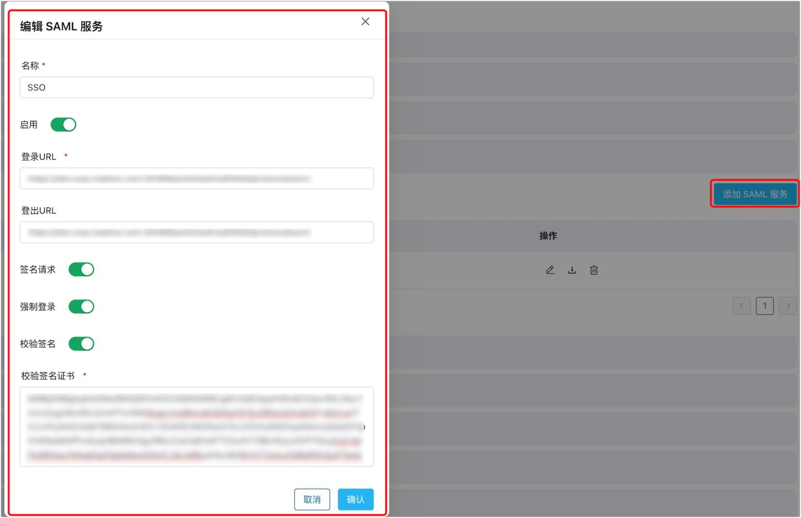

# SAML

ECP 支持集成基于 SAML 2.0 协议的第三方认证系统。如需配置 OIDC，请参阅 [OIDC](./oidc.md)。

SAML（Security Assertion Markup Language）是一种基于 XML 的开放标准协议，用于在跨网络通信中传递身份验证和授权数据。SAML 旨在促进各种网络资源之间的安全通信和用户身份验证的单点登录（SSO），使得不同组织间的用户可以使用单个身份验证登录不同的系统和服务，无需为每个服务单独登录和身份验证。

## 配置 SAML

1. 使用**系统管理员**账户登录 ECP。
2. 在系统管理界面，点击**系统设置**-> **通用配置** -> **单点登录**。
3. 点击**添加认证服务**，将**协议**选为 **SAML 2.0**，然后填写以下配置。
   - 添加 SSO **名称**；
   - 点击**启用** SAML 服务；
   - 填写**登录 URL**，即第三方认证的登录地址；
   - [可选] 填写**登出 URL**，即第三方认证的登出地址；
   - [可选] 选择是否开启**签名请求**，如开启，ECP 会自动生成一个签名；
   - [可选] 选择是否开启**强制登录**，如开启，当用户通过第三方登录时，ECP 会要求其输入用户名密码；
   - [可选] 选择是否开启**校验签名**，如开启，请上传从第三方认证系统导出的公钥文件（经 Base64 加密）；
   - [可选] 选择是否开启**自动绑定 IdP 用户**，如开启，第三方认证系统使用的用户邮箱将绑定 ECP 的用户邮箱，在用户使用单点登录时，自动完成 ECP 端的用户创建或激活；如未开启，使用第三方认证系统首次登录 ECP 时，用户需手动填写注册信息以完成 ECP 端的用户创建。
   - 点击**确认**，以上配置生效。

