# 单点登录

使用单点登录（SSO），用户可以用企业身份提供商中的账号登录 ECP。ECP 支持 OpenID Connect（OIDC）和 SAML 2.0。本页以 Okta 为例，介绍如何配置 OIDC 服务以及用户如何登录。如需配置 SAML，请参阅[配置 SAML 单点登录](./ecp_login.md#配置单点登录)。

## 关于 Okta

Okta 是企业身份与访问管理平台，管理员可以用它统一管理企业账号、应用访问权限和多重验证。接入 ECP 后，用户在 Okta 验证企业身份，再返回 ECP。了解更多，请访问 [Okta 官网](https://www.okta.com/)，或查看 [Okta 单点登录介绍](https://www.okta.com/products/single-sign-on-workforce-identity/)。

## 管理员配置

### 准备工作

- 准备 ECP 系统管理员账号，以及具有管理应用和分配用户权限的 Okta 管理员账号。

- 在 ECP 的**系统设置** -> **通用配置**中设置[访问地址](../system_admin/general_config.md#访问域名)。使用用户实际打开 ECP 登录页的 HTTPS 地址，确保协议、域名和端口一致。

  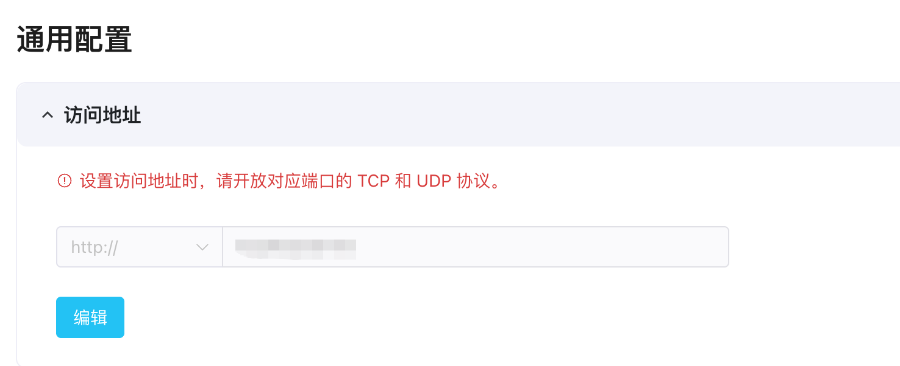

- 确认 ECP 服务端可以通过 HTTPS 访问您组织的 Okta 域名。在生产环境中使用自定义授权服务器前，请确认 Okta 组织已启用 API Access Management。本文以 `default` 为例，也可以使用组织为 ECP 指定的自定义授权服务器。详见 [Okta 授权服务器配置](https://developer.okta.com/docs/guides/customize-authz-server/)。

### Okta 前置准备

已有企业 Okta 组织时，请使用该组织的管理员账号登录。首次接入 Okta 时，按以下步骤开通组织。

#### 首次开通组织

1. 准备企业名称和负责开通的管理员邮箱，通过 [Okta 联系页面](https://www.okta.com/contact/)联系销售，开通用于企业单点登录的生产组织。如需先熟悉控制台，可另行[注册 Okta Integrator Free Plan](https://developer.okta.com/signup/)，用于非生产环境。两类组织的说明见 [Okta 组织文档](https://developer.okta.com/docs/concepts/okta-organizations/)。
2. 收到组织开通信息后，记录组织登录地址，例如 `https://your-company.okta.com`。按收到的指引激活管理员账号并完成所需的身份验证设置。
3. 打开组织登录地址，使用管理员账号登录，点击页面右上角的 **Admin** 进入 **Admin Console**。

#### 准备用户和用户组

- 在 **Directory** -> **People** 中确认需要登录 ECP 的员工账号已激活，并维护有效的主邮箱。如果用户尚未加入组织，点击 **Add Person** 添加用户，请用户按组织的要求完成账号激活。详见 [Okta 手动添加用户](https://help.okta.com/oie/en-us/content/topics/users-groups-profiles/usgp-add-users.htm)。
- 如果计划按组分配 ECP 应用，在 **Directory** -> **Groups** 中确认用户已加入目标组。创建应用后，再到应用的 **Assignments** 标签页授予访问权限。

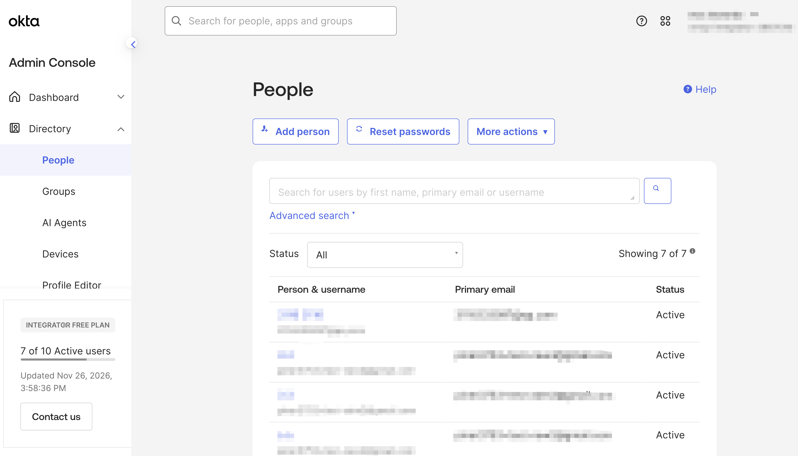

### 1. 获取 ECP 登录重定向 URI

1. 使用系统管理员账号登录 ECP，进入**系统设置** -> **通用配置** -> **单点登录**。
2. 点击**添加认证服务**，将**协议**选为 **OpenID Connect**。
3. 点击**登录重定向 URI**旁的复制按钮。地址形如 `https://ecp.example.com/api/sso/oidc/callback`。保留此页面，取得 Okta 的客户端凭据后再回来保存。

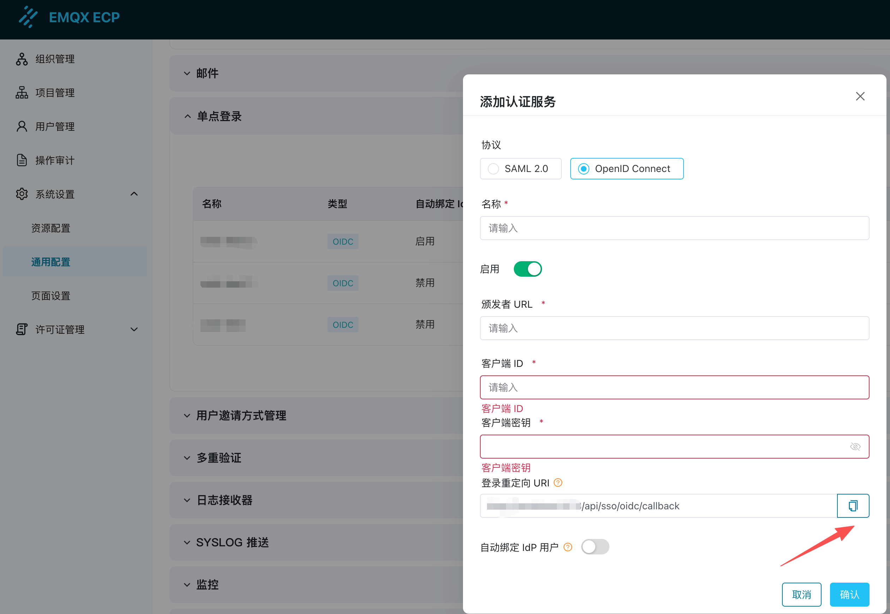

### 2. 在 Okta 创建应用并分配用户

1. 登录 Okta Admin Console，进入 **Applications and Resources** -> **Applications**，点击 **Create App Integration**。部分组织需要先选择 **Classic experience**。
2. 将 **Sign-in method** 设为 **OIDC - OpenID Connect**，将 **Application type** 设为 **Web Application**，然后点击 **Next**。

   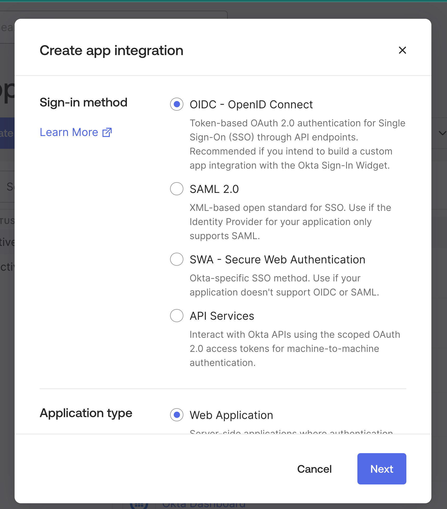

3. 输入应用名称，例如 `ECP`。配置以下选项后，点击 **Save**。

   - **Client definition**：建议选择 **Use Okta-generated client ID**。创建向导中也可能显示为 **Configure in Okta**。由 Okta 生成的 **Client ID** 可直接填入 ECP。
   - **Grant type**：选择 **Authorization Code**。

     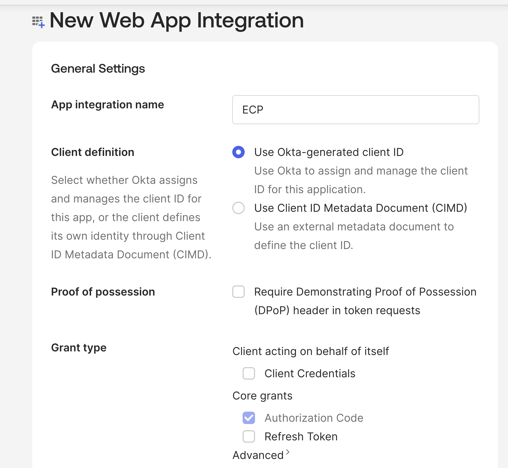

   - **Sign-in redirect URIs**：填写从实际部署的 ECP 复制的完整登录重定向 URI。

     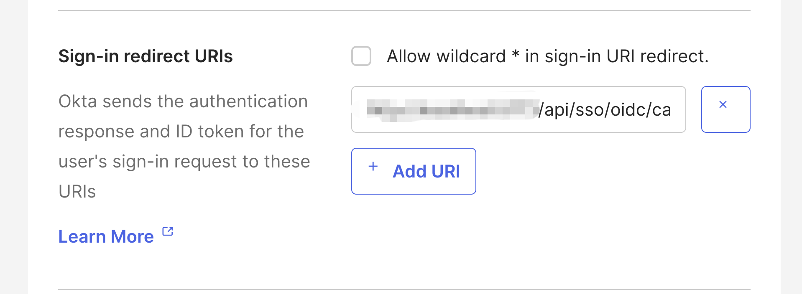

   - **Controlled access**：建议选择 **Skip group assignment for now**。先保存应用，再在 **Assignments** 中为需要访问 ECP 的用户或组授权。

     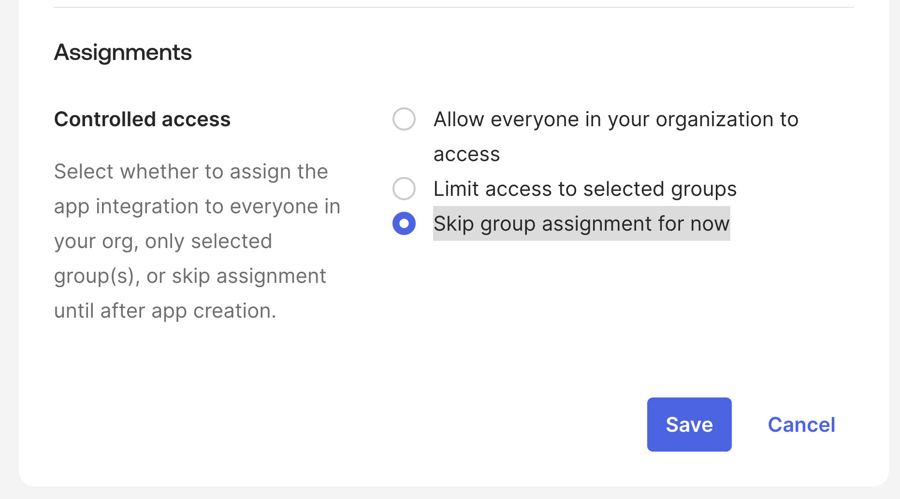

   详见 [Okta OIDC 应用配置](https://help.okta.com/oie/en-us/content/topics/apps/apps_app_integration_wizard_oidc.htm)。
4. 在应用的 **General** 标签页记录 **Client ID** 和 **Client Secret**。客户端认证方式使用 **Client secret**。
5. 在应用的 **Assignments** 标签页，点击 **Assign**，将应用分配给可以登录 ECP 的用户或用户组。详见 [Okta Web 应用配置](https://developer.okta.com/docs/guides/sign-into-web-app-redirect/main/)。

> **截图待补** Okta 应用的 Assignments 标签页，显示已分配的示例用户或组。`./_assets/oidc-okta-assignments.png`

### 3. 获取 Okta 颁发者 URL

1. 在 Okta Admin Console 中进入 **Security** -> **API** -> **Authorization Servers**，打开您为 ECP 选用的自定义授权服务器，例如 **default**。
2. 在授权服务器列表中查看 **Issuer URI**，或打开该服务器的 **Settings** 后复制该值。例如 `https://example.okta.com/oauth2/default`。

   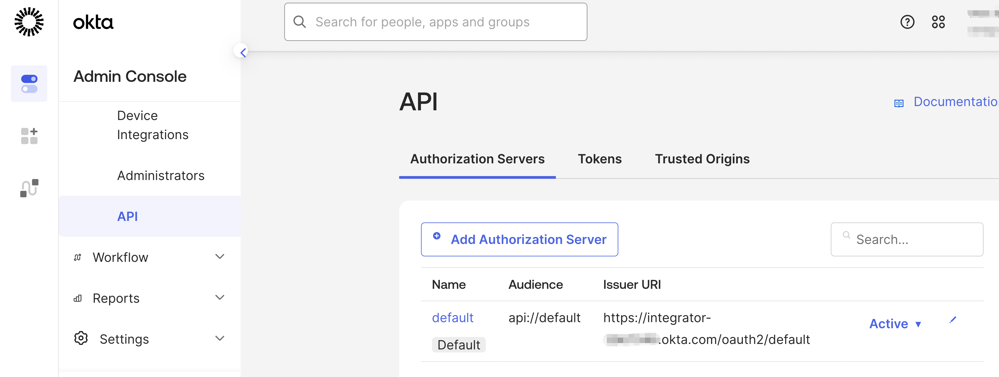

3. 在 **Access Policies** 中确认有适用于该应用的策略和规则。规则须允许已分配的用户使用 **Authorization Code**，并允许 ECP 请求 `openid`、`profile` 和 `email`。如果没有匹配的策略，点击 **Add Policy**，将策略分配给 ECP 应用，再点击 **Add Rule**，为已分配的用户添加授权码规则。详见 [Okta 访问策略配置](https://developer.okta.com/docs/guides/customize-authz-server/)。

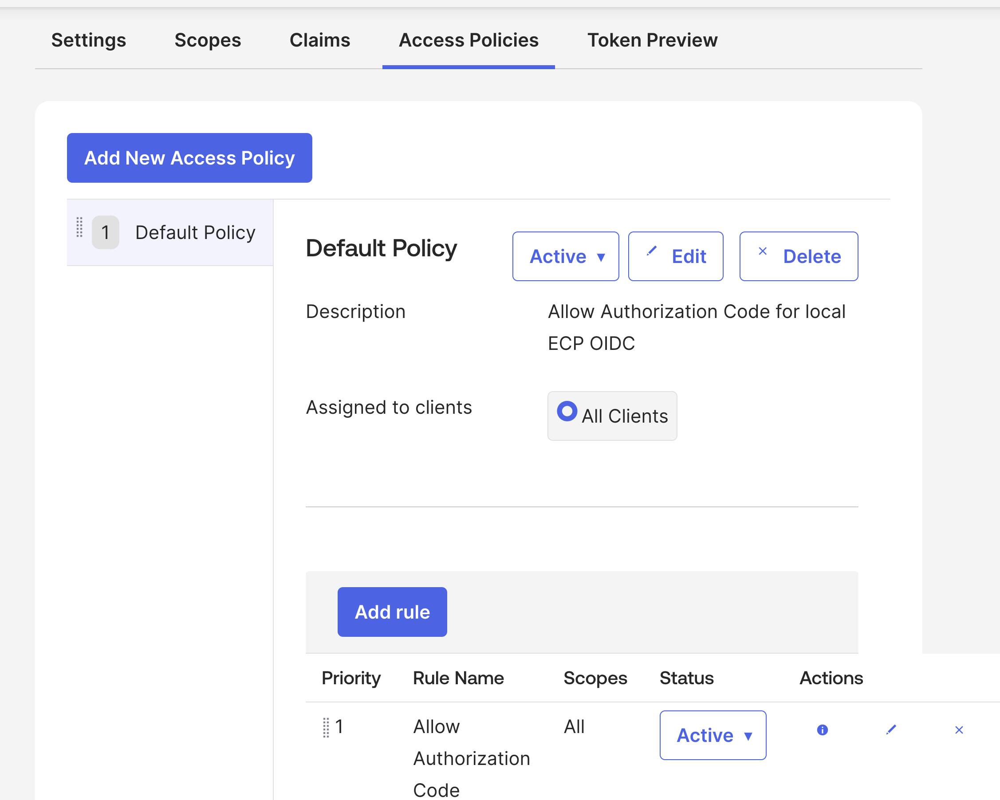

### 4. 在 ECP 保存并启用服务

1. 返回 ECP 的**添加认证服务**弹窗，填写下列字段。

   | 字段 | 设置 |
   | --- | --- |
   | **名称** | 登录页显示的服务名称，例如 `Okta 企业登录`。 |
   | **颁发者 URL** | 从 Okta 授权服务器复制的 **Issuer URI**。 |
   | **客户端 ID** | 在 Okta 应用中取得的 **Client ID**。 |
   | **客户端密钥** | 在 Okta 应用中取得的 **Client Secret**。 |
   | **自动绑定 IdP 用户** | 默认关闭，新用户首次登录时需要手动激活。开启后，ECP 根据 Okta 提供的邮箱匹配现有 SSO 账号，如无匹配则自动创建 SSO 账号。 |

   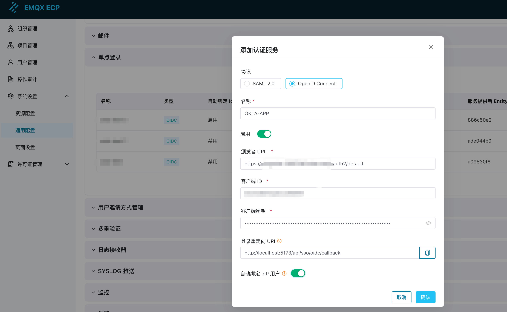

2. 打开**启用**，点击**确认**。ECP 登录页会显示此服务。
3. 使用获准访问 ECP 的企业账号，从实际部署的 ECP 登录地址完成登录。确认可以进入 ECP 并访问该账号应有权限的组织和项目后，将 ECP 登录地址和服务名称告知使用者。

:::tip
已有 ECP 本地密码账号或邀请账号的用户，应继续使用原有方式登录。如果 SSO 登录提示邮箱已被占用，请联系 ECP 管理员。项目访问权限由 ECP 管理员另行分配。
:::

### 管理已配置的服务

- 在**单点登录**列表点击编辑图标，可以更新配置。更换 Okta 密钥后，在**客户端密钥**中填入新值并保存。
- 要停止通过该服务登录，在编辑页面关闭**启用**。已有 ECP 会话按原有效期继续使用。
- 如果列表显示有**已绑定用户**，可通过禁用服务停止登录。删除服务前须先确保没有用户绑定到该服务。

### 查看 SSO 用户并分配项目权限

在 ECP 的**系统管理** -> **用户管理**中，按邮箱查找用户。**SSO 用户**列显示该账号是否为 SSO 账号，**状态**列显示账号是否已激活。

- **SSO 用户**使用企业身份提供商登录。ECP 中的**重置密码**不可用。如需重置 Okta 密码，请通过 Okta 处理。
- **非 SSO 用户**只能使用 ECP 邮箱和密码登录。即使 Okta 使用相同邮箱，该账号也无法通过单点登录进入 ECP。

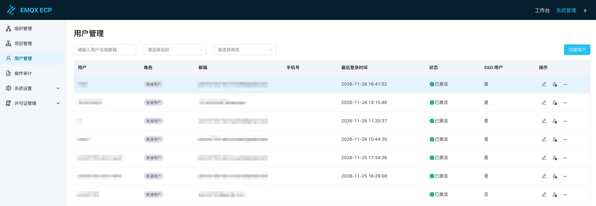

用户首次通过 SSO 登录时，如果 ECP 为其新建了账号，该账号默认没有组织或项目成员资格，因此无法访问组织和项目资源。管理员可按以下步骤授权。

1. 在**组织管理**中编辑目标项目所属的组织，将用户加入该组织。详见[编辑组织及成员](../system_admin/org_management.md#编辑组织及成员)。
2. 在**项目管理**中找到要分配的项目，点击**操作**栏的编辑图标。
3. 在**可用用户**中勾选该用户，在**项目成员**中设置所需角色并保存。详见[编辑项目及成员](../system_admin/project_management.md#编辑项目及成员)。

## 使用 Okta 登录 ECP

1. 打开 ECP 登录页，点击管理员提供的单点登录服务，例如 **Okta 企业登录**。

   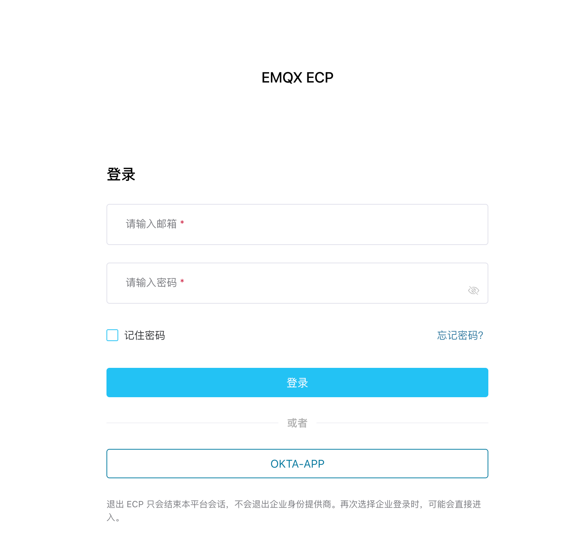

2. 在 Okta 页面使用企业账号登录。如 Okta 要求多重验证，按页面提示完成验证。

   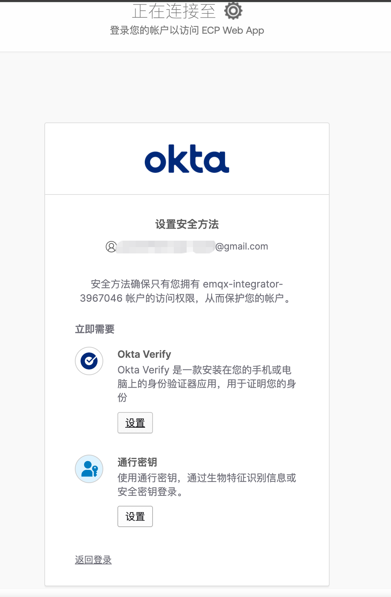

3. 浏览器返回 ECP。若首次登录时出现激活页面，请填写用户名和页面要求的其他字段，再点击**确认**。页面会自动填入来自 Okta 的邮箱。

   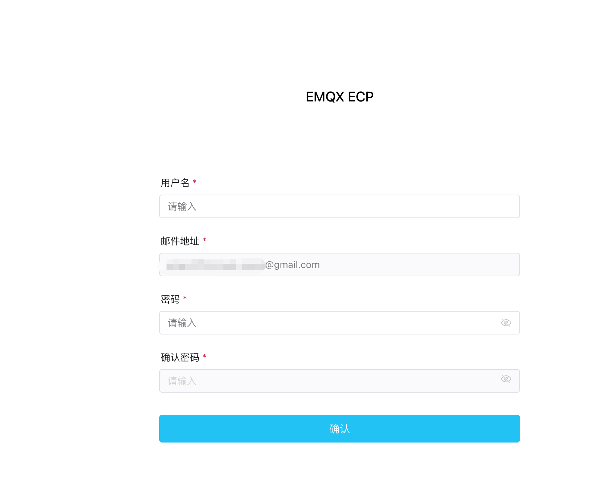

如果首次登录后看不到组织或项目，请联系 ECP 管理员为您分配项目。

退出 ECP 后，Okta 会话可能仍然有效。在同一浏览器再次选择企业登录时，Okta 可能会直接将您带回 ECP。若要切换企业账号，请先退出 Okta，或使用隐私窗口重新登录。

## 常见问题

| 现象 | 处理方式 |
| --- | --- |
| 登录页没有 Okta 入口 | 请管理员确认 ECP 中的认证服务已启用。 |
| Okta 提示重定向 URI 不匹配 | 从 ECP 重新复制**登录重定向 URI**，核对 Okta 的 **Sign-in redirect URIs**，包括协议、域名、端口和路径。 |
| Okta 提示无权访问应用 | 请 Okta 管理员检查应用分配和授权服务器的访问策略。 |
| ECP 提示登录已失效 | 从 ECP 登录页重新选择企业登录服务，并在发起登录的同一浏览器中完成登录。 |
